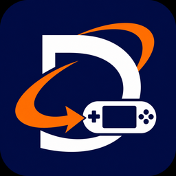

# DCRC



**An open-source platform for porting Dreamcast games to PSP.** DCRC includes a
Windows converter, an SH-4 recompiler, a PSP runtime, and guides and agent skills
for researching and developing new ports. The converter builds a PSP folder
locally from the user's own supported disc.

**DCRC is an independent fork of [sa1-psp](https://github.com/countallegrex/sa1-psp),
created by CountAllegrex.** CountAllegrex's MIT emitter, runtime, HLE and backends
are the foundation. **SandstoneDev** developed the DCRC converter and toolkit,
adapted the runtime, and continues to improve the project.
See [CREDITS.md](CREDITS.md), [NOTICE.md](NOTICE.md) and [LICENSE](LICENSE).
The converter workflow was inspired by [PS2RC](https://github.com/SandstoneDev/PS2RC);
its custom-licensed implementation is not copied here.

## Quick start on Windows

1. [Download the Windows x64 ZIP](https://github.com/SandstoneDev/DCRC/releases/download/v0.1.0-preview.3/DCRC-Converter-Windows-x64-v0.1.0-preview.3.zip) from the [latest release](https://github.com/SandstoneDev/DCRC/releases/latest).
2. Extract the entire archive into a writable folder and run **DCRC Converter.exe**.
3. Select your own **Sonic Adventure Dreamcast USA V1.005** GDI and keep its track files alongside it.
4. Choose an output folder, then click **Convert** on the last tab.
5. Copy the generated game folder into `PSP/GAME` on your PSP and launch it from the PSP menu.

The portable ZIP includes **Python and the PSP toolchain**, along with Qt,
FFmpeg, FFprobe and the ATRAC encoder. Everything needed for conversion runs
from the extracted folder.

## Status

This is a public preview. The first compatibility profile is **Sonic Adventure,
Dreamcast USA V1.005**. Other games and disc revisions require their own porting
work. The converter builds the PSP game locally from your own disc.

The reviewed source profile deliberately uses locally translated original
functions instead of several handwritten native accelerators. Its supported
renderer is TA, with full static draw distance. A separately attributed BSD
reference LFO is used by the host sound mixer. Performance, LFO phase/noise and
audio parity are not asserted to match other builds. Rendering/memory/audio
issues remain; real PSP validation is required for speed and quality claims.

## What you need

- Windows 10 or 11 (x64).
- A PSP with 64 MB of RAM that can run homebrew, such as a PSP-2000 or
  PSP-3000. **PSP-1000 is unsupported** because it has 32 MB of RAM.
- Several gigabytes of free local work space, plus the generated PSP folder.

### Recommended PSP settings

We recommend **ARK-5** for this preview. In its custom firmware settings,
set **CPU Clock in Game** to **443 MHz** and **Use Extra Memory** to **MAX**.
The 443 MHz overclock is optional. If your PSP is unstable at that setting,
use 333 MHz. Report your PSP model, CPU clock and memory setting with test results.

## Converter options

The six steps are Disc, Output, Appearance, Settings, Controls and Convert.
Selecting a disc checks its version automatically; Convert also performs the
check when needed. Choose an exact new output folder, then use **Convert** on
the last step. Disc/DLC/media operations stay on their current step. Normal game
boot is the default. Optional stage/character/act warps override it explicitly. World texture
caps64/128 affect selected Emerald Coast assets and reduce detail; original
textures are available. Reduced static distance is unavailable in this TA profile.

Appearance combines the local game title, an own-disc image gallery or supplied
pictures, XMB music preview and a selected 1–10 second clip. Custom 4:3 side
images are made locally from the user's image. The source repository contains
no game artwork or private default border. Digital control assignments map PSP
buttons to Dreamcast actions; physical HOME and the DCRC menu chord remain available.

Movie playback, custom borders and dithering depend on the reviewed runtime
capabilities, not just visible controls. See [profile support](docs/COMPATIBILITY.md)
and [converter usage](converter/README.md) for the available options.

The resulting folder contains `EBOOT.PBP`, helpers and `data/`. Keep generated
game files, saves and captures private.

In the PSP game, **L+R+Cross+Down** opens the control menu. Release all buttons,
then use L/R for pages and the D-pad to edit. Settings, bounded cheats, startup
level/character selection and opaque user-supplied DLC mounts are described in
[the menu guide](docs/IN_GAME_MENU.md). Optional `--dlc-dir` imports your own
extracted VMI/VMS folder locally. Explicit catalogue/download actions can also
retrieve selected events into local work; checked events are prepared before
Convert. Failure/cancellation stops the job. This is opaque import, not a promise
of playable DLC; see the menu guide and profile support limits.

## Run from source

Install the source dependencies from the official Python package index:

```sh
python -m pip install -r requirements.txt
python -B -m dcrc doctor --toolchain "<native-PSP-SDK>"
python -B -m dcrc identify "<your-disc.gdi>"
python -B -m dcrc convert "<your-disc.gdi>" --out "<new-PSP-folder>" --toolchain "<native-PSP-SDK>"
```

For the optional window:

```sh
python -m pip install -r requirements-gui.txt
python -B gui/run_gui.py
```

## Settings, resume and recovery

Open a terminal in the extracted portable folder to use the command-line tools.

```powershell
.\dcrc.cmd verify "<PSP-folder>"
.\dcrc.cmd configure "<PSP-folder>" --stage normal --voice en
.\dcrc.cmd repair "<PSP-folder>" --source "<your-disc.gdi>"
```

GUI and CLI use the same core. Complete stages are reused only after content
verification; changing the output folder still stages its files. Runtime settings
need no compilation; world texture changes repeat asset conversion. Player saves
and unknown files are preserved by repair. Cancellation shuts down owned processes
and keeps work for diagnosis. The GUI saves one dated session log automatically
and provides **Open logs folder**. Portable apps use their own `logs` directory;
source/read-only layouts use the application-data fallback. Logs may contain
local input paths: review/redact them before a public bug report. No converter
action automatically deploys to a card.

## Port another Dreamcast game

1. Start with the [porting skill](.agents/skills/dcrc-port-game/SKILL.md) and its
   [new-game guide](.agents/skills/dcrc-port-game/references/another-game.md).
   Record the exact disc revision, executable and overlays from your input.
2. Install analysis and build tools using the [dependency guide](docs/DEPENDENCIES.md)
   and the [source and licence index](dependencies.json). The
   [dependency-research skill](.agents/skills/dcrc-dependency-research/SKILL.md)
   explains how to find and validate a replacement when a tool or link is missing.
3. Follow the [development guide](docs/DEVELOPMENT.md) to research guest calls and
   hardware behavior, define profile facts and bindings, generate code, and test
   each implemented service against the game's actual use.
4. Record test coverage in the [compatibility guide](docs/COMPATIBILITY.md) and
   check the export with [the release audit](docs/RELEASE_AUDIT.md). Use PPSSPP
   for functional and visual checks and PSP hardware for acceptance.

| Location | Purpose |
|---|---|
| `dcrc/`, `gui/` | Shared converter and optional PySide6 window |
| `recomp/emitter/` | Own SH-4 decoder, CFG/lowering and C runtime ABI |
| `recomp/sa1_us_1005/`, `dcrc/data/` | Address/hash/format compatibility facts |
| `hle/`, `backend/` | Host HLE, TA parser, PSP/desktop backends |
| `tools/`, `tests/` | Analysis, generation, diagnostics and synthetic checks |
| `.agents/skills/` | Portable porting, dependency-research and release-audit skills |
| `audit/` | Reviewed per-file provenance and publication rules |

Read [AGENTS.md](AGENTS.md), [development](docs/DEVELOPMENT.md),
[provenance](docs/PROVENANCE.md) and [release audit](docs/RELEASE_AUDIT.md).
The toolkit is gradually extracted from a working first game. A second game has
not established general portability; adding a game requires analysis, bindings,
runtime work and tests, not just selecting another disc image.

Optional PSP homebrew guidance: [psp-developer by SandstoneDev](https://github.com/SandstoneDev/psp-developer).
This is an external reference, not a bundled skill or DCRC dependency. Its
separate PS2RC License 1.2 is source-available, not MIT; see the
[pinned reference and licence](.agents/skills/dcrc-port-game/references/public-resources.md).

## Community and contributions

Fork DCRC, make improvements in your fork, and send a pull request. Share what
changed, which configuration you tested, and how to reproduce the result.
See [the contribution guide](CONTRIBUTING.md) and join [Discord](https://discord.gg/wV8x46ZTDu).

## Credits and licences

Converter/frontend/integration: **SandstoneDev**. Foundation: **CountAllegrex**.
The project retains MIT notices for those portions and BSD-3-Clause notices for
the specifically identified adaptations. External tools keep their own licences.
[CREDITS.md](CREDITS.md) lists actual components and references, including the
PSPDEV community, MAME, Python, Qt/PySide, Pillow, pyelftools and test/discovery tools.

This project is not affiliated with or endorsed by SEGA or Sony. Compatibility
and platform names are used to identify supported inputs/targets; all marks and
commercial game materials remain with their respective owners.
